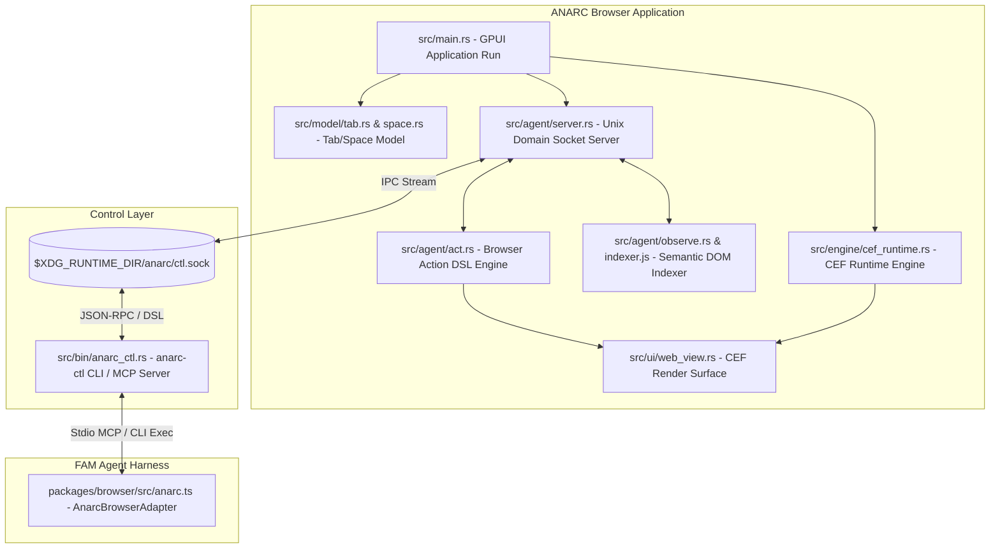
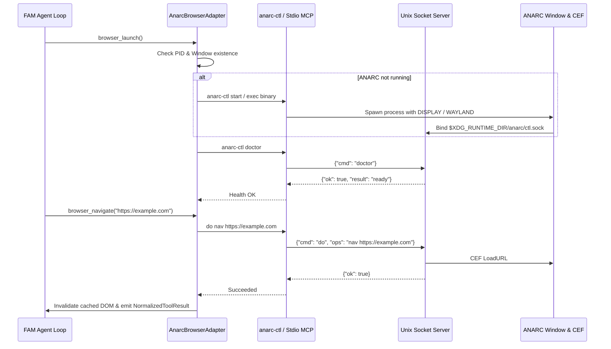

# ANARC Browser Architecture & Integration Audit

**Target System**: ANARC (Rust + GPUI + CEF Autonomous Browser)  
**Repository Path**: `/home/krishna/anarc`  
**Host Environment**: Linux Omarchy (Kernel 7.2.15, Wayland/X11), Rust 1.98.1, CEF v156.4.0+156.0.26

---

## 1. Executive Summary

ANARC is a high-performance web browser written in Rust using the GPUI application framework (from Zed Industries) and the Chromium Embedded Framework (CEF). Unlike standard consumer browsers that require external WebDriver or CDP wrappers (such as Playwright or Puppeteer), ANARC natively embeds a bidirectional agent control daemon and automation protocol designed specifically for AI agent control.

This audit analyzes ANARC's internal architecture, process lifecycle, IPC sockets, action DSL, DOM inspection mechanisms, and stdio MCP server to establish a reliable, verified integration with FAM.

---

## 2. ANARC Architecture & Process Model



### 2.1 Key Modules & Responsibilities
- `src/main.rs`: Entry point initializing GPUI `Application::new().run(...)`, window configuration, and CEF initialization.
- `src/engine/cef_runtime.rs`: Configures and hosts the CEF life cycle, browser settings, process message loops, and off-screen / windowed render callbacks.
- `src/model/tab.rs` & `src/model/space.rs`: Tab lifecycle, active tab tracking, pinned tabs, and workspace partitioning ("Spaces").
- `src/agent/server.rs`: The IPC socket server. Binds to `$XDG_RUNTIME_DIR/anarc/ctl.sock` (or `%LOCALAPPDATA%\anarc\ctl.sock` on Windows). Enforces peer UID verification (`verify_peer_uid`) on Unix to ensure only the local user can execute agent commands.
- `src/agent/protocol.rs`: Core command protocol (`AgentRequest` / `AgentResponse`). Exposes structured commands: `see`, `read`, `find`, `tabs`, `doctor`, `do`, `shot`, `attach`, `pause`, `resume`, `status`.
- `src/agent/observe.rs` & `indexer.js`: Injects JavaScript into the active frame to extract all visible, interactable elements and assign deterministic short references (`e1` for links, `i1` for inputs, `b1` for buttons).
- `src/agent/act.rs`: Action interpreter executing high-level operations: `click <ref>`, `type <ref> <text>`, `key <chord>`, `scroll <direction>`, `nav <url>`, `tab new <url>`, `tab close <id>`, `tab select <id>`.
- `src/bin/anarc_ctl.rs`: Multi-purpose CLI tool and stdio MCP server (`anarc-ctl mcp`). Translates MCP JSON-RPC protocol requests into native socket messages sent to the ANARC server.

---

## 3. Discovered Automation & Control Interfaces

ANARC provides three complementary control interfaces:

### 3.1 Direct Stdio MCP Server (`anarc-ctl mcp`)
`anarc-ctl` implements the Model Context Protocol over stdio. When launched with `anarc-ctl mcp`, it exposes the following MCP tools:
1. `see`: Generates a compact index of interactable elements on the active page or scoped subtree.
2. `read`: Reads page content in modes: `text` (clean markdown/text), `table`, `links`, or `outline` (headings hierarchy).
3. `find`: Searches elements matching a text query and returns up to 5 element refs.
4. `tabs`: Lists all open tabs, active tab ID, pinned status, URLs, and page titles.
5. `tab`: Controls tabs: `new`, `close`, `pin`, `unpin`, `fav`, `unfav`, `select`.
6. `do`: Executes action DSL strings: `click`, `type`, `key`, `scroll`, `wait stable`, `nav`.
7. `shot`: Captures viewport or element screenshot and returns either base64 image data or local PNG filepath (`--shot-as`).
8. `upload`: Attaches local files to file input elements.
9. `doctor`: Performs end-to-end socket diagnostics, verifying IPC communication and CEF responsiveness.

### 3.2 Action DSL (`do` command syntax)
ANARC parses a concise, human-readable action language:
- `click <ref>` or `<ref>` (e.g. `do i1`, `do b2`)
- `type <ref> <text>` or `fill <ref> <text>` (e.g. `do type i1 hello@example.com`)
- `key <chord>` (e.g. `do key Enter`, `do key BackSpace`, `do key Tab`)
- `scroll <down|up|top|end>` (e.g. `do scroll down`)
- `nav <url>` (e.g. `do nav https://wikipedia.org`)
- `wait <ms|stable>` (e.g. `do wait stable 500`)
- `tab <new|close|select> [target]` (e.g. `do tab new https://example.com`)

### 3.3 Semantic DOM Indexing (`see` command output)
The output of `see` provides semantic accessibility representations:
```text
[b1] "Submit" (button)
[i1] "Email Address" (input:text, value="")
[e1] "Privacy Policy" (link, href="/privacy")
```
This DOM-first approach drastically outperforms visual coordinate clicking in speed, reliability, and token efficiency.

---

## 4. Architectural Gaps & Integration Vulnerabilities

1. **Process Launch & Visible Window Verification**:
   - `packages/browser/src/anarc.ts` currently checks socket connectivity or executes `anarc-ctl start`, but does not verify whether the visible window has rendered and is ready to accept user input.
   - If ANARC is launched in a headless environment without an active display server or XDG runtime directory, the process may spawn but freeze without listening on the socket.
2. **Missing Tool Schema Parity**:
   - The user specification requires 25 explicit browser operations (`browser_launch`, `browser_connect`, `browser_status`, `browser_close`, `browser_new_tab`, `browser_navigate`, `browser_back`, `browser_forward`, `browser_reload`, `browser_tabs`, `browser_switch_tab`, `browser_close_tab`, `browser_get_url`, `browser_get_title`, `browser_read`, `browser_read_dom`, `browser_read_links`, `browser_screenshot`, `browser_click`, `browser_type`, `browser_fill`, `browser_select`, `browser_scroll`, `browser_press_key`, `browser_wait`, `browser_execute_js`).
   - While `packages/browser/src/tools.ts` implements many descriptors, several handlers in `anarc.ts` lack robust parameter mapping to `anarc-ctl do` and socket calls.
3. **Observation Invalidation on Navigation**:
   - When `browser_navigate` succeeds, existing element refs (`i1`, `b1`) become stale. Currently, FAM does not purge previous DOM observations from the prompt builder context, causing models to attempt interactions with elements that no longer exist on the new page.
4. **Untrusted Web Content Shielding**:
   - Webpage content extracted via `read` or `see` must be tagged as untrusted content (`<untrusted_browser_content>`) to defend against indirect prompt injection.

---

## 5. Recommended Overhaul Architecture



### Key Recommendations:
1. Implement a bulletproof `launch()` method that resolves `anarc` binary location (`/home/krishna/anarc/target/release/anarc` or system path), verifies the process PID, and checks X11/Wayland window state.
2. Complete all 25 browser tool handlers in `packages/browser/src/anarc.ts` and ensure full schema validation.
3. Implement deterministic DOM observation invalidation upon every navigation or tab switch event.
4. Wrap all webpage extracted text in defensive boundaries (`<untrusted_web_content>`) before injecting into history.
