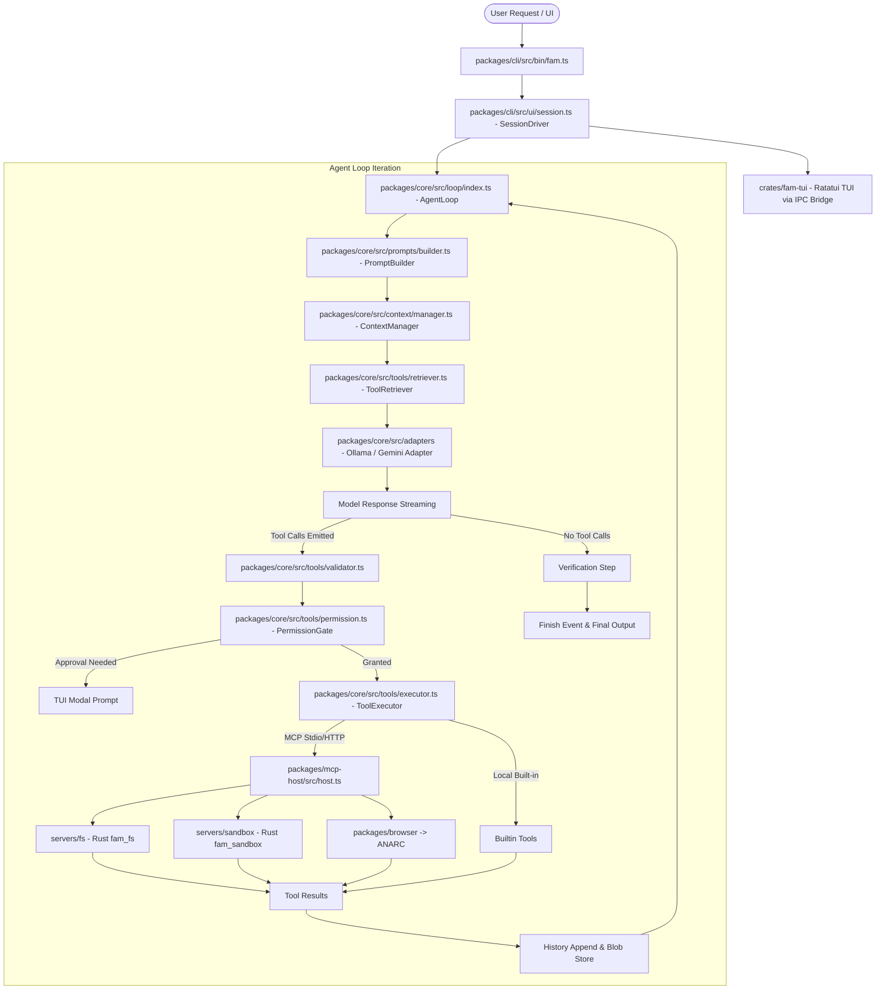

# FAM Architecture Audit

**Target System**: FAM (Local Autonomous AI Agent Harness)  
**Repository Path**: `/home/krishna/Projects/harness`  
**Host Environment**: Linux Omarchy (Kernel 7.2.15, Arch-based x86_64), AMD Ryzen 7 7435HS (16 vCPUs), 24GB RAM, NVIDIA GeForce RTX 4050 Laptop GPU (6GB VRAM, CUDA 13.4, Driver 615.78.08).  
**Runtime**: Node.js v22.23.4, pnpm v12.9.1, Rust/Cargo 1.98.1, Ollama v0.40.7.

---

## 1. Executive Summary

This architecture audit examines the end-to-end execution path, component modularity, state transitions, model interactions, and failure modes across FAM. While FAM features a sophisticated monorepo structure and foundational MCP integration, critical architectural gaps undermine determinism, truthfulness, and resilience:
1. **Unverified Task Completion**: The agent loop marks a task as `COMPLETED` whenever the model ceases to emit tool calls, even if requested file operations, scripts, or browser actions were never executed or failed during execution.
2. **Context Bleed & Stale Observations**: Conversation history retains observations across task boundaries without invalidating outdated DOM snapshots, cached file contents, or changed working directories.
3. **Tool Execution Contract Divergence**: Tool results are represented as unstructured string payloads rather than validated, grounded execution records with verified statuses, durations, and task correlations.
4. **Administrative Privilege Void**: FAM lacks a secure privilege escalation broker, meaning system maintenance and developer environment operations either fail or rely on unsafe raw shell commands.
5. **Browser Lifecycle & Session Management**: While `@fam/browser` exists, it relies on loose socket detection without verifying visible application windows or maintaining deterministic tab/session state.

---

## 2. End-to-End Information Flow



---

## 3. Component-by-Component Audit & Findings

### 3.1 Application Entry Point & Session Management
- **Source**: `packages/cli/src/bin/fam.ts`, `packages/cli/src/ui/session.ts`
- **Current Behavior**: Parses CLI flags via Commander, starts `fam doctor`, `fam eval`, `fam replay`, or launches the full Ratatui TUI (`crates/fam-tui`) communicating over stdio JSON lines. `SessionDriver` initializes MCP host, config, and adapters.
- **Root Cause & Vulnerabilities**:
  - `SessionDriver` initializes MCP servers lazily in the background (`void this.initMcp()`) without awaiting server readiness before accepting user prompts, leading to race conditions where tools are missing on the initial turn.
  - Multi-task conversational state persists indefinitely in `history`, without explicit task isolation boundaries or session resets.
- **Recommended Changes**:
  - Enforce explicit `await this.initMcp()` readiness barrier before accepting input.
  - Inject explicit `taskId` for every user input turn and encapsulate execution context per task.

### 3.2 Agent Loop & State Machine
- **Source**: `packages/core/src/loop/index.ts`, `packages/core/src/loop/state-machine.ts`
- **Current Behavior**: Implements a while loop bounded by `maxSteps` (default 30). Transitions through states: `IDLE` -> `UNDERSTANDING` -> `PLANNING` -> `DISCOVERING_TOOLS` -> `REASONING` -> `EXECUTING` -> `OBSERVING` -> `RECOVERING` -> `VERIFYING` -> `COMPLETED`.
- **Root Cause & Vulnerabilities**:
  - The state machine does not match the strict lifecycle required: `IDLE`, `PLANNING`, `TOOL_SELECTION`, `AWAITING_APPROVAL`, `EXECUTING`, `OBSERVING`, `VERIFYING`, `REPLANNING`, `COMPLETED`, `FAILED`, `CANCELLED`.
  - Termination condition flaw: In `packages/core/src/loop/index.ts:517-533`, if `turnToolCalls.length === 0`, the loop transitions directly to `VERIFYING` and `COMPLETED`. If a user requested "Create script X and run it", and the model generates a narrative description without calling `fs_write_file` or `run_command`, FAM marks the task as `COMPLETED` without verifying execution evidence.
  - No structured planning step: Complex requests do not generate a structured execution plan before tool execution begins.
- **Recommended Changes**:
  - Refactor `state-machine.ts` to implement the 11 explicit states.
  - Introduce an `ExecutionPlan` structure and enforce an internal planning phase for complex tasks.
  - Require verifiable evidence (successful tool results associated with plan milestones) before allowing transition to `COMPLETED`. If evidence is missing, force `REPLANNING` or transition to `FAILED`.

### 3.3 LLM Adapter Layer
- **Source**: `packages/core/src/adapters/ollama.ts`, `packages/core/src/adapters/gemini.ts`
- **Current Behavior**: Streams responses from local Ollama (`/api/chat`) and remote Gemini. Implements fallback regex parsing for small models that emit XML `<tool_call>` or JSON text blocks instead of native tool calls.
- **Root Cause & Vulnerabilities**:
  - Small models (e.g. Qwen 2.5 1.5B / Qwen 2.5 Coder 7B) occasionally produce malformed arguments or mixed text/tool output. While text fallback exists, it does not assign stable synthetic tool IDs, leading to mismatched responses.
  - Token usage statistics are estimated rather than tracked through exact Ollama prompt evaluation metrics when streaming.
- **Recommended Changes**:
  - Ensure synthetic call IDs are deterministic and tracked in the execution ledger.
  - Calibrate prompt evaluation and completion token tracking directly from Ollama response metrics.

### 3.4 Tool Execution & Normalization Contract
- **Source**: `packages/core/src/tools/executor.ts`, `packages/shared/src/types/message.ts`
- **Current Behavior**: `ToolExecutor` handles parallel read-only tools and serializes write operations. Results are returned as `{ callId, name, content, isError }`.
- **Root Cause & Vulnerabilities**:
  - Missing standardized execution contract: Does not track `execution_id`, `task_id`, `arguments`, `duration_ms`, `verified`, or structured `status` (`pending`, `running`, `succeeded`, `failed`, `approval_required`, `cancelled`, `timed_out`).
  - Without structured tool results, downstream components cannot verify whether file contents were written, return codes were zero, or DOM operations actually modified state.
- **Recommended Changes**:
  - Implement a `NormalizedToolResult` contract adhering to:
    ```typescript
    export interface NormalizedToolResult {
      execution_id: string;
      task_id: string;
      tool: string;
      status: 'pending' | 'running' | 'succeeded' | 'failed' | 'approval_required' | 'cancelled' | 'timed_out';
      arguments: Record<string, unknown>;
      result: Record<string, unknown>;
      error: string | null;
      duration_ms: number;
      verified: boolean;
    }
    ```
  - Validate the result schema before emitting to the agent loop or context history.

### 3.5 Filesystem Server (`servers/fs`)
- **Source**: `servers/fs/src/` (Rust crate `fam_fs`)
- **Current Behavior**: Provides `read_file`, `write_file`, `create_file`, `append_file`, `apply_edit`, `glob`, `grep`, `copy`, `move`, `rename`, `delete`, `trash`, `repo_map`. Enforces path confinement and symlink traversal prevention.
- **Root Cause & Vulnerabilities**:
  - Lacks dedicated tools for directory creation (`create_directory`), directory removal (`delete_directory`), structured file parsing (JSON/YAML/CSV inspection), and file type classification.
  - Confinement checks assume a single workspace root; attempts to read authorized user directories (e.g. `~/Downloads`) without explicit environment variable overrides can fail ungracefully.
- **Recommended Changes**:
  - Add explicit tools: `fs_create_directory`, `fs_delete_directory`, `fs_file_type`, `fs_compare_files`, `fs_read_structured`.
  - Return structured verification metadata (file size, SHA256 hash, timestamps) on all mutations.

### 3.6 Terminal Execution & Sandbox Server (`servers/sandbox`)
- **Source**: `servers/sandbox/src/` (Rust crate `fam_sandbox`)
- **Current Behavior**: Executes shell commands, python scripts, node scripts, and code snippets with timeouts and stdout/stderr capture.
- **Root Cause & Vulnerabilities**:
  - Zero privilege escalation architecture: FAM cannot perform legitimate administrative commands (installing packages, restarting services, inspecting system logs) without failing or resorting to unsafe execution.
  - Sudo password handling is completely absent, meaning any `sudo` invocation hangs waiting for stdin or fails immediately.
- **Recommended Changes**:
  - Design and implement a dedicated `PrivilegeBroker` adhering to `FAM -> PermissionGate -> PrivilegeBroker -> OS`.
  - Support structured administrative capabilities with native authentication prompts, redacting secrets from all logs, model messages, and MCP servers.

### 3.7 Context & Observation Management
- **Source**: `packages/core/src/context/`
- **Current Behavior**: Token budget management, blob offloading (`blob_read`, `blob_grep`), history compaction using local 1.5B model.
- **Root Cause & Vulnerabilities**:
  - Observation staleness: When a browser navigates to a new page, or a file is overwritten, previous observations remain in context without invalidation markers.
  - Cross-task bleed: Multi-turn conversations retain old task outputs, causing small models to reuse stale file paths or command results.
- **Recommended Changes**:
  - Implement task-scoped execution contexts with explicit observation invalidation on state changes.
  - Invalidate DOM snapshots upon navigation and file content caches upon write/move/delete operations.

---

## 4. Verification & Baseline Status
- **Vitest Suite**: 59 test files, 254 tests passing.
- **Cargo Suite**: 11 `fam_fs` tests, 7 `fam_sandbox` tests, 16 `fam_tui` tests passing.
- **Conclusion**: The foundational codebase compiles and passes its current unit tests, but requires systematic structural hardening across lifecycle management, tool contracts, permissions, and browser integration to achieve true autonomous reliability.
