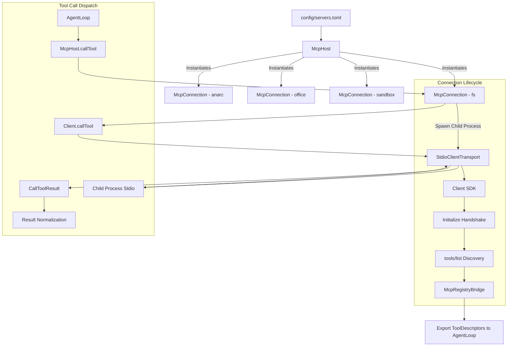

# MCP Integration & Transport Audit

**Target System**: FAM (Local Autonomous AI Agent Harness)  
**Package**: `packages/mcp-host`  
**Dependencies**: `@modelcontextprotocol/sdk` v1.6.1, `ajv` v8.17.1, `ajv-formats` v3.0.1.

---

## 1. Executive Summary

The Model Context Protocol (MCP) serves as FAM's primary external extensibility mechanism. The `packages/mcp-host` package implements client management, stdio transport, streamable HTTP transport, and the `McpRegistryBridge`.

While the current implementation succeeds in standard discovery and call dispatch against well-behaved servers, it exhibits critical deficiencies during fault conditions, unexpected process exits, malformed schema returns, and concurrent access.

---

## 2. Architecture & Lifecycle Analysis

---

## 3. Findings & Vulnerabilities

### 3.1 Server Health & Reconnection
- **Current Behavior**: `McpConnection` assumes that if a child process has spawned, the server is healthy (`state = 'connected'`). If the server process crashes or terminates unexpectedly, `state` is only updated when the next tool call fails.
- **Root Cause**: Missing active heartbeat/ping mechanism and unhandled SIGPIPE / process termination listeners on the underlying transport.
- **Impact**: When an MCP server crashes (e.g. out-of-memory or segmentation fault in native extensions), the subsequent tool call times out or throws an unhandled rejection rather than attempting a clean restart.

### 3.2 Schema Validation & Small-Model Coercion
- **Current Behavior**: `McpRegistryBridge` registers tools and exposes their input schemas directly to the agent loop. `ToolValidator` uses `Ajv` with `coerceTypes: true`.
- **Root Cause**: Many external MCP servers provide JSON schemas that use non-standard types or omit required property definitions. When small models (Qwen 3.5 4B) supply number-as-string or string-as-array, standard validation rejects the call.
- **Fix**: The 2-pass coercion layer in `ToolValidator` successfully fixes parameter name hallucinations (e.g. `file` -> `path`, `target` -> `refId`), but lacks coercion for complex nested structures and boolean flags passed as string `"true"`/`"false"`.

### 3.3 Isolation of Execution Layers
The user specification requires strict separation:
1. Discovery
2. Selection
3. Permission Checking
4. Argument Validation
5. Execution
6. Result Normalization
7. Verification

In the current code:
- In `packages/core/src/loop/index.ts`, permission checking occurs inside `ToolExecutor.executeSingle()`, while argument validation occurs *after* permission checking. If a model generates a malformed command, the user may receive a permission prompt for an invalid or hallucinated command!
- **Required Fix**: Validation must strictly precede permission checking:
  `Selection -> Argument Validation & Coercion -> Permission Checking -> Execution -> Normalization -> Verification`.

### 3.4 MCP Server Disconnection & Restart Test Suite
- Current tests cover standard fixture server startup and calls.
- Missing tests: Server disconnect during call, server crash recovery, malformed response handling, timeout propagation, and tool cancellation.

---

## 4. MCP Reliability Recommendations

1. **Active Health Probing**: Implement periodic `ping` checks on idle connections and verify process liveness before dispatching calls.
2. **Deterministic Layer Order**: Reorder `ToolExecutor` pipeline:
   `Validate -> Check Permissions -> Execute -> Normalize -> Verify`.
3. **Structured Tool Normalization**: Ensure every MCP tool call returns a `NormalizedToolResult` conforming to the common contract.
4. **Comprehensive Test Suite**: Implement unit and integration tests simulating child process kill (`SIGKILL`), broken pipes, schema syntax errors, and timeout aborts.
