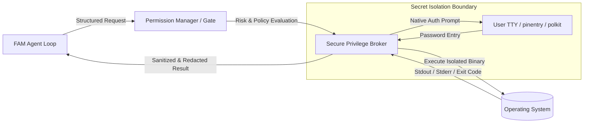

# Permission & Privilege Escalation Audit

**Target System**: FAM (Local Autonomous AI Agent Harness)  
**Package**: `packages/core/src/tools/permission.ts`, `config/policy.toml`  
**Security Architecture**: Tier-based capability containment and Privilege Escalation Broker.

---

## 1. Executive Summary

Autonomous AI agents operating on developer machines require nuanced permission boundaries:
- They must freely create, inspect, refactor, and test code within their workspace without prompting the user for approval on every trivial edit or file deletion.
- They must require explicit user confirmation for actions outside the workspace or actions with irreversible consequences.
- When legitimate administrative operations are requested (e.g. installing dependencies, restarting developer daemons, inspecting system logs), they must escalate privileges through a secure, auditable broker without ever leaking user credentials to the LLM or persistent storage.

This audit evaluates FAM's current permission implementation and specifies the architecture for the new `PrivilegeBroker`.

---

## 2. Current Permission Architecture & Gaps

### 2.1 Tier Classification
FAM currently implements five tiers in `packages/core/src/tools/permission.ts`:
- **Tier 0**: Read-only, ambient, idempotent (no prompt).
- **Tier 1**: Normal workspace mutations (no prompt if within authorized workspace).
- **Tier 2**: Potentially sensitive operations: running arbitrary shell commands, external network access, modifying files outside workspace roots (prompts user unless on `commandPrefixAllowlist`).
- **Tier 3**: High-impact modifications: permanent deletion, moving directories, large-scale replaces.
- **Tier 4**: Dangerous / Administrative: root escalation, system reboots, disk partitions.

### 2.2 Critical Vulnerabilities & Gaps
1. **Total Absence of Secure Privilege Broker**:
   - FAM currently possesses no mechanism to execute privileged (`sudo`) tasks.
   - Any attempt by the model to call `sudo apt install` or `sudo systemctl restart` hangs indefinitely waiting for a TTY password prompt or fails with `sudo: a terminal is required to read the password`.
2. **Credential Leakage Hazard**:
   - Without an isolated broker, users or naive agents might attempt to pass passwords in shell strings (e.g. `echo password | sudo -S ...`).
   - If executed, the password is permanently captured in shell history, FAM JSONL execution traces, LLM conversation history, and sent upstream to the model provider on the next turn.
3. **Workspace Escape & Path Confinement**:
   - `PermissionGate.isPathAuthorized` checks whether a resolved path starts with an authorized root. However, path normalization did not consistently resolve symlinks before checking, creating potential symlink traversal vectors.
4. **Deny Override Precedence**:
   - In `permission.ts:127-130`, explicit `deny` patterns correctly override allow rules, but session grants (`sessionGrants`) were evaluated without re-checking against high-risk Tier 3/4 constraints.

---

## 3. Secure Privilege Broker Architecture

To fulfill user requirement 4.2–4.4, we implement the following four-tier architecture:

### 3.1 Strict Security Rules
1. **Zero Credential Exposure**: Passwords entered by the user are held exclusively in volatile memory within the broker process and immediately wiped. Credentials are NEVER passed to:
   - Ollama or Gemini model adapters.
   - Conversation history or messages.
   - MCP servers or child processes.
   - JSONL traces, debug logs, or stdout.
   - Configuration files or environment variables.
2. **Structured Administrative Commands**:
   - The agent does not execute arbitrary `sudo bash` root shells.
   - Instead, the agent invokes structured administrative tools:
     - `admin_inspect_system`: Inspect processes, disk usage (`df -h`), memory (`free -m`), system logs (`journalctl`).
     - `admin_manage_service`: Query status or restart approved developer services (`systemctl restart ...`).
     - `admin_install_package`: Install or update authorized packages.
     - `admin_run_privileged`: For arbitrary privileged shell commands, FAM displays the exact command, warns the user, and requires explicit user terminal authorization.

---

## 4. Implementation Plan for Permission Hardening

1. Implement `PrivilegeBroker` in `packages/core/src/tools/privilege-broker.ts`.
2. Provide integration with native terminal authentication (using `/dev/tty` or `askpass` fallback).
3. Connect `PrivilegeBroker` to `ToolExecutor` and add administrative tool descriptors.
4. Add comprehensive test suite in `packages/core/src/__tests__/privilege-broker.test.ts` verifying password redaction, authorization rejection, and command execution.
